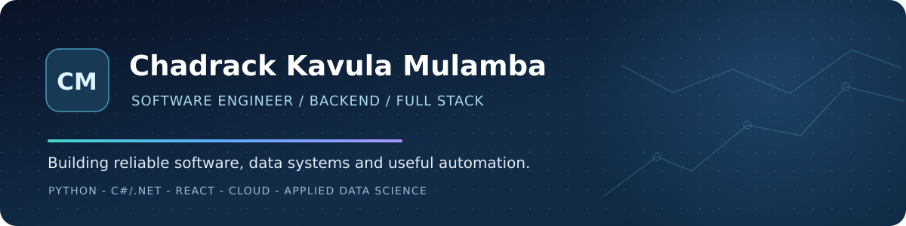

<!-- GitHub profile README for github.com/chadrack-123 -->

  <a href="https://chadrack-portfolio.vercel.app/">Portfolio</a> &nbsp;&bull;&nbsp;
  <a href="https://www.linkedin.com/in/chadrack-kavula-mulamba-67457318b/">LinkedIn</a> &nbsp;&bull;&nbsp;
  <a href="mailto:chadrackmulamba2@gmail.com">Email</a>

  
  
  

### About me

I'm **Chadrack**, a South Africa-based software engineer with **4+ years of experience** designing, building and supporting backend and full-stack applications. I enjoy turning complex requirements into dependable software, from API and database design to frontends, testing and deployment.

I previously worked as a **Lead Software Developer at the University of Johannesburg** and hold a **Master of Applied Data Science**. My Diploma, Advanced Diploma, BCom Honours and Master's qualifications were all completed **with distinction**.

My current interests include **distributed systems, secure APIs, practical AI-assisted development, mobile experiences, and reproducible machine learning**.

### Technology stack

**Languages and backend**

**Frontend and mobile**

**Data, cloud and engineering**

I also use **GitHub Copilot** to accelerate implementation and testing, with human review of generated code.

### Selected work

| | |
|:--|:--|
| **Uconnect - student platform**   Mobile and web-oriented social platform with identity, permissions, communities and messaging.   `FastAPI` `PostgreSQL` `Redis` `Docker` `React Native`   [Architecture notes](case-studies/uconnect.md) | **Termiite - secure automation**   Private access and proposal workflow with authentication, Cloudflare D1 and email notifications.   `React` `Cloudflare Workers` `D1`   [Engineering case study](case-studies/termiite.md) \| [Website](https://termiite.co.za/) |
| **Mpox reproducibility framework**   Research tooling for repeatable ML experiments, model evaluation, configuration and documentation.   `Python` `ML` `Reproducibility`   [Explore repository](https://github.com/chadrack-123/Framework_GARMF_Mpox) | **Developer portfolio**   A responsive portfolio highlighting engineering experience, selected projects and technical interests.   `Next.js` `TypeScript` `React`   [Live site](https://chadrack-portfolio.vercel.app/) \| [Source](https://github.com/chadrack-123/chadrack_portfolio) |

Some client and in-progress application code is private. The linked case studies describe the engineering work without exposing private repositories or credentials.

### What matters in my engineering work

- **Reliability:** automated tests, careful debugging, monitoring failures and understanding deployment environments.
- **Security:** authentication, role-based access controls, input validation and safe configuration.
- **Data quality:** thoughtful database design, reproducible experiments and traceable results.
- **Clear collaboration:** useful documentation, code reviews and communicating across technical and non-technical teams.

### Let's connect

I am interested in software engineering roles spanning **backend, full-stack, cloud and data-intensive applications**. Feel free to explore my work or reach out through [LinkedIn](https://www.linkedin.com/in/chadrack-kavula-mulamba-67457318b/) or [email](mailto:chadrackmulamba2@gmail.com).
